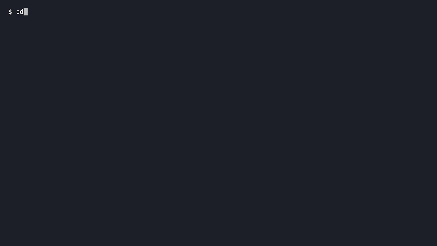

# agent-preflight

Check a cloned repo **before** you let an AI coding agent (Claude Code, Codex, Cursor, Copilot, Gemini CLI, Windsurf) open it.

Researchers recently reported repos that hide instructions in CLAUDE.md and agent hooks to hijack coding agents: steal secrets, phone home, run code on session start, or quietly override you. `agent-preflight` reads the agent instruction and config files in a repo and flags those tricks. It is read-only and never executes, imports, or sources anything from the repo it scans. Standard library only, Python 3.9+.



_The repo in the first half of the demo is a fake one built to show the hidden-text trick._

## Install

```
pipx install git+https://github.com/ankit-agenticapps/agent-preflight
```

or clone and run it directly:

```
git clone https://github.com/ankit-agenticapps/agent-preflight
cd agent-preflight && python3 -m agent_preflight /path/to/repo
```

## Usage

```
agent-preflight                       # scan the current directory
agent-preflight ~/src/some-repo       # scan one repo
agent-preflight a b c --json          # several repos, JSON output
agent-preflight --all-repos ~/clones  # every subfolder is a repo, with a summary table
agent-preflight . --min-severity high --no-color
```

Exit code: `2` if any HIGH finding, `1` if any MEDIUM (and no HIGH), otherwise `0`. With `--min-severity`, findings below that level are hidden and ignored for the exit code.

## What it checks

Files: CLAUDE.md, CLAUDE.local.md, AGENTS.md, GEMINI.md, .cursorrules, .windsurfrules, .github/copilot-instructions.md, .cursor/rules, .claude/commands, agents and skills, nested CLAUDE.md / AGENTS.md (4 levels deep), .claude/settings*.json, .mcp.json, .cursor/mcp.json, .vscode/settings.json and tasks.json, .devcontainer/devcontainer.json, package.json scripts, .codex/config.toml.

| ID | Severity | Rule |
|----|----------|------|
| PF001 | HIGH | A Claude Code hook runs a shell command (SessionStart, UserPromptSubmit, PreToolUse run automatically) |
| PF002 | HIGH | Network call that can send data out (curl, wget, nc, iwr, fetch, requests.post ...) |
| PF003 | HIGH | Secret access: ~/.ssh, cloud credentials, .env, keychain, env dumps, named API keys |
| PF004 | HIGH | Remote script execution: `curl ... \| sh`, `bash <(curl ...)`, `iex (iwr ...)` |
| PF005 | HIGH | Hidden Unicode: zero-width, bidi overrides, tag characters (payloads are decoded and shown) |
| PF006 | HIGH | VS Code task that auto-runs on folder open |
| PF101 | MED | Tries to override you: "ignore previous instructions", "do not tell the user" ... |
| PF102 | MED | Permission bypass: --dangerously-skip-permissions, Bash(*), bypassPermissions, MCP autoApprove |
| PF103 | MED | MCP server that is unpinned (npx/uvx/pipx/bunx without a version) or a remote URL |
| PF104 | MED | package.json install scripts or devcontainer start commands that use the network |
| PF105 | MED | Long base64 blobs or base64 decoding |
| PF201 | LOW | Instructions tell the agent to run commands at the start of a session |
| PF202 | LOW | Links to domains not on a short well-known list |
| PF203 | LOW | Config file is not valid JSON (text-scanned instead) |

## What it doesn't do

- It is heuristic pattern matching, not a guarantee. A clean result does not prove a repo is safe, and some findings will be false alarms.
- It does not scan source code, dependencies, or build scripts beyond the files listed above.
- It never executes, imports, or sources anything from the scanned repo, and never follows symlinks out of it.

## Demo

`demo/make_demo_repos.py [DIR]` writes a trapped and a clean repo to `/tmp/preflight-demo` (or DIR) so you can see the output. The trapped files are generated on demand and are not stored in this repository, so opening this repo with an agent is safe.

## Contributing

Issues and pull requests welcome. Add a test in `tests/` for every rule change; test fixtures must be generated in temp dirs at test time, never committed as live files. Run `python3 -m unittest -v`.

## License

MIT
